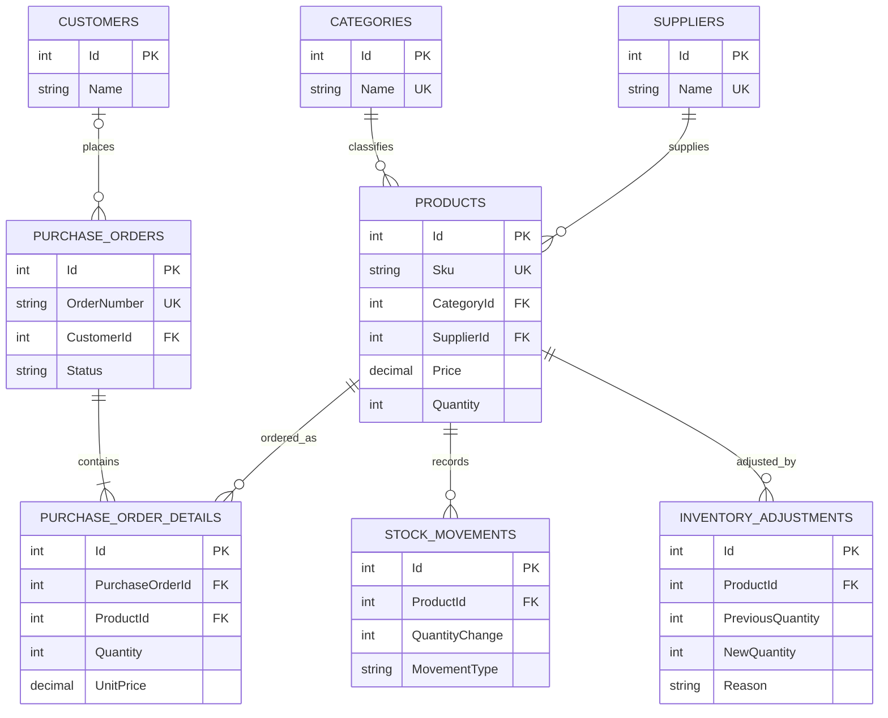

# Entity Relationship Diagram

The model has eight tables. Foreign keys preserve relationships. Product SKU, category name, supplier name, and order number are unique. Product prices and order-line prices are stored on their respective entities; order-line price records the price at the time of the order. Customer details are kept separately from orders to avoid repeating them. Stock movements and inventory adjustments are separate audit records. These choices support 3NF because non-key attributes describe their own table's entity and do not depend on other non-key attributes.
